# Lab 8.2 – Sauvegarde, restauration et mise à jour d'un cluster k3s

> **Auteur :** Nawres Zarrouki
> **Cours :** Orchestration de conteneurs avec Kubernetes (k3s) – chapitre 8

Dans le rôle de l'administrateur d'un cluster de production : **sauvegarde** de l'etcd, **incident** (suppression accidentelle d'un namespace), **restauration**, constat de ce que la sauvegarde ne couvre pas (les données des volumes), **maintenance** d'un nœud, puis **mise à jour** des trois serveurs un par un sans interrompre l'application.

## Sommaire

1. [Objectifs et contexte](#1-objectifs-et-contexte)
2. [Étape 1 : application avec des données](#2-étape-1--application-avec-des-données)
3. [Étape 2 : snapshot etcd et copie hors serveur](#3-étape-2--snapshot-etcd-et-copie-hors-serveur)
4. [Étape 3 : l'incident](#4-étape-3--lincident)
5. [Étape 4 : restaurer le cluster](#5-étape-4--restaurer-le-cluster)
6. [Étape 5 : maintenance d'un nœud](#6-étape-5--maintenance-dun-nœud)
7. [Étape 6 : mise à jour des trois serveurs](#7-étape-6--mise-à-jour-des-trois-serveurs)
8. [Questions de réflexion](#8-questions-de-réflexion)
9. [Dépannage et nettoyage](#9-dépannage-et-nettoyage)
10. [Résumé des captures](#10-résumé-des-captures)

---

## 1. Objectifs et contexte

- Créer un snapshot etcd et en conserver une **copie hors du serveur**.
- Restaurer le cluster après la suppression accidentelle d'un namespace.
- Constater ce que la sauvegarde du cluster **ne couvre pas** (données des volumes).
- Mettre un nœud en maintenance avec `cordon`, `drain` et `uncordon`.
- Mettre à jour les trois serveurs, **un par un**, sans interrompre l'application.

```
Application      Snapshot etcd       Incident :        Restauration     Vérification :    Maintenance    Mise à jour
+ données   ──►  + copie hors   ──►  namespace    ──►  du snapshot ──►  objets revenus,──► d'un nœud ──► des 3 serveurs
                 serveur             supprimé                           données perdues ?
```

**Prérequis :** Lab 8.1 réalisé (cluster à 3 serveurs `Ready`, installé en `<VERSION_INITIALE>`) et un snapshot VMware de chaque VM.

> **Versions de k3s :** `<VERSION_INITIALE>` est la version installée au Lab 8.1, `<VERSION_CIBLE>` la version mineure suivante, au format `v1.<mineure>.<correctif>+k3s<n>`. On ne saute **jamais** de version mineure.

---

## 2. Étape 1 : application avec des données

Une application possède des objets Kubernetes (ConfigMap, deux Deployments) et des données dans un volume (PVC `local-path`).

```bash
k create namespace tp-k8s
k apply -f appli.yaml -n tp-k8s
k rollout status deployment/web -n tp-k8s
k rollout status deployment/donnees -n tp-k8s
k exec -n tp-k8s deploy/donnees -- sh -c 'echo "donnee importante" > /data/important.txt'
k exec -n tp-k8s deploy/donnees -- cat /data/important.txt
k get all,pvc,configmap -n tp-k8s -o wide
```

_(fichier `appli.yaml` absent du dépôt)_

Nœud qui héberge le Pod `donnees` et dossier du volume sur ce nœud :

```bash
NODE=$(k get pod -n tp-k8s -l app=donnees -o jsonpath='{.items[0].spec.nodeName}')
echo $NODE
sudo ls /var/lib/rancher/k3s/storage/      # sur ce nœud
```

**Point de contrôle :**

- [x] Les Pods `web` (3) et `donnees` (1) sont `Running`
- [x] `important.txt` contient `donnee importante`
- [x] Le nœud `$NODE` et le dossier du volume sont repérés

<!-- capture à ajouter : captures/01-appli-donnees.png -->

---

## 3. Étape 2 : snapshot etcd et copie hors serveur

Sur `k3s-server1` :

```bash
sudo k3s etcd-snapshot save --name avant-incident
sudo k3s etcd-snapshot ls
sudo ls -lh /var/lib/rancher/k3s/server/db/snapshots/
```

Le fichier appartient à `root` : il est copié dans le dossier personnel, puis **hors du serveur** (sur `k3s-server2`) :

```bash
SNAP=$(sudo ls /var/lib/rancher/k3s/server/db/snapshots/ | grep avant-incident | tail -n 1)
echo $SNAP
sudo cp /var/lib/rancher/k3s/server/db/snapshots/$SNAP ~/$SNAP
sudo chown $USER:$USER ~/$SNAP
scp ~/$SNAP <UTILISATEUR>@<IP_S2>:~/
```

Une ressource est ensuite ajoutée **après** le snapshot, pour vérifier la restauration :

```bash
k create configmap apres-snapshot --from-literal=note="creee apres la sauvegarde" -n tp-k8s
k get configmap -n tp-k8s
```

**Point de contrôle :**

- [x] `etcd-snapshot ls` liste `avant-incident`
- [x] Une copie du fichier existe sur `k3s-server2`
- [x] Le ConfigMap `apres-snapshot` existe, mais n'est pas dans le snapshot

<!-- capture à ajouter : captures/02-snapshot-etcd.png -->

---

## 4. Étape 3 : l'incident

Un administrateur supprime par erreur le namespace de l'application :

```bash
k delete namespace tp-k8s
k get namespace
k get pv
sudo ls /var/lib/rancher/k3s/storage/      # sur le nœud $NODE
```

Le namespace, ses Pods, ses ConfigMaps et son PVC disparaissent. Sur `$NODE`, le **dossier du volume est lui aussi supprimé**.

**Point de contrôle :**

- [x] Le namespace `tp-k8s` n'existe plus
- [x] Le dossier du volume a disparu de `/var/lib/rancher/k3s/storage/` sur `$NODE`

<!-- capture à ajouter : captures/03-incident-namespace.png -->

---

## 5. Étape 4 : restaurer le cluster

**1. Arrêter k3s sur les trois serveurs** (une commande sur chaque VM) :

```bash
sudo systemctl stop k3s
```

**2. Sur `k3s-server1` uniquement, restaurer le snapshot :**

```bash
sudo k3s server --cluster-reset --cluster-reset-restore-path=/var/lib/rancher/k3s/server/db/snapshots/$SNAP
```

Une fois le message de fin de réinitialisation affiché (« redémarrer sans l'option `--cluster-reset` »), redémarrage du service :

```bash
sudo systemctl start k3s
sudo systemctl status k3s --no-pager
```

**3. Sur `k3s-server2` puis `k3s-server3`**, l'ancien état etcd est mis de côté et le serveur rejoint le cluster restauré :

```bash
sudo mv /var/lib/rancher/k3s/server/db /var/lib/rancher/k3s/server/db.bak
sudo systemctl start k3s
```

<!-- capture à ajouter : captures/04-restauration.png -->

**4. Vérification depuis `k3s-server1`** : ce qui est revenu, et ce qui manque :

```bash
k get nodes
k get namespace
k get all,pvc,configmap -n tp-k8s
k get configmap apres-snapshot -n tp-k8s
k rollout status deployment/web -n tp-k8s
k rollout status deployment/donnees -n tp-k8s
k exec -n tp-k8s deploy/donnees -- ls -l /data
k exec -n tp-k8s deploy/donnees -- cat /data/important.txt
```

**Point de contrôle :**

- [x] Les trois nœuds sont `Ready`
- [x] Le namespace `tp-k8s`, le Deployment `web`, le ConfigMap `important` et le PVC sont revenus
- [x] Le ConfigMap `apres-snapshot` n'existe plus (créé après le snapshot)
- [x] `important.txt` est **introuvable** : la sauvegarde du cluster ne contient pas les données des volumes

<!-- capture à ajouter : captures/05-verification-restauration.png -->

---

## 6. Étape 5 : maintenance d'un nœud

La donnée du volume est recréée, puis le nœud qui héberge le Pod `donnees` est vidé :

```bash
k exec -n tp-k8s deploy/donnees -- sh -c 'echo "donnee importante" > /data/important.txt'
NODE=$(k get pod -n tp-k8s -l app=donnees -o jsonpath='{.items[0].spec.nodeName}')
echo $NODE
k get pods -n tp-k8s -o wide

k cordon $NODE
k get nodes
k drain $NODE --ignore-daemonsets --delete-emptydir-data
k get pods -n tp-k8s -o wide
k describe pod -n tp-k8s -l app=donnees | tail -n 6
```

Les Pods `web` sont recréés sur les autres nœuds. Le Pod `donnees` reste `Pending` : son volume `local-path` n'existe que sur `$NODE`. Le nœud est ensuite rétabli :

```bash
k uncordon $NODE
k get pods -n tp-k8s -o wide -w
k exec -n tp-k8s deploy/donnees -- cat /data/important.txt
```

**Point de contrôle :**

- [x] Après `cordon`, le nœud est `SchedulingDisabled`
- [x] Après `drain`, aucun Pod `web` ne reste sur `$NODE`
- [x] Le Pod `donnees` est resté `Pending` (affinité de volume), puis `Running` après `uncordon`, donnée intacte

### Cordon et drain

<!-- capture à ajouter : captures/06-cordon-drain.png -->

### Retour du nœud

<!-- capture à ajouter : captures/07-uncordon.png -->

---

## 7. Étape 6 : mise à jour des trois serveurs

Avant toute mise à jour : nouveau snapshot et contrôle des versions.

```bash
sudo k3s etcd-snapshot save --name avant-maj      # sur k3s-server1
k get nodes -o wide
```

Dans un second terminal, une boucle de requêtes vers l'application (NodePort créé avec `k expose deployment web --port=80 --type=NodePort -n tp-k8s`) :

```bash
while true; do curl -s -m 2 -o /dev/null -w "%{http_code} " http://<IP_S3>:<NODEPORT>; sleep 1; done
```

**Un serveur à la fois**, en commençant par `k3s-server1`, dans cet ordre : `drain`, mise à jour, vérification, `uncordon`.

```bash
k drain <NOM_DU_SERVEUR> --ignore-daemonsets --delete-emptydir-data
export K3S_TOKEN=<JETON>
curl -sfL https://get.k3s.io | INSTALL_K3S_VERSION=<VERSION_CIBLE> sh -s - server --cluster-init     # k3s-server1
curl -sfL https://get.k3s.io | INSTALL_K3S_VERSION=<VERSION_CIBLE> sh -s - server --server https://<IP_S1>:6443    # k3s-server2 et k3s-server3
k get nodes
k uncordon <NOM_DU_SERVEUR>
```

> Le jeton (`<JETON>`) n'est pas écrit dans ce dépôt.

Entre deux mises à jour, le nœud doit être `Ready` avec la nouvelle version avant de passer au suivant :

```bash
k get nodes -o wide
```

<!-- capture à ajouter : captures/08-mise-a-jour.png -->

Contrôle final du cluster et de l'application :

```bash
k get nodes
k get pods -A
k get deployment -n tp-k8s
sudo k3s --version
```

**Point de contrôle :**

- [x] Un snapshot `avant-maj` a été créé avant de toucher aux nœuds
- [x] Les trois serveurs affichent `<VERSION_CIBLE>` et sont `Ready`
- [x] La boucle de requêtes n'a eu que de rares échecs pendant l'opération
- [x] Tous les Pods de `kube-system` et de `tp-k8s` sont `Running`

<!-- capture à ajouter : captures/09-versions-finales.png -->

---

## 8. Questions de réflexion

**1. Pourquoi `important.txt` n'est-il pas revenu après la restauration ?**
Le snapshot etcd ne contient que les **objets Kubernetes** (Deployments, ConfigMaps, PVC…), pas le contenu des volumes. Avec `local-path`, les données sont un simple dossier sur le disque du nœud, et ce dossier a été supprimé avec le namespace. Le PVC est revenu, mais vide.

**2. Pourquoi le ConfigMap `apres-snapshot` a-t-il disparu ?**
Un snapshot est une photographie de l'état à un instant précis. Tout ce qui est créé après n'y figure pas : restaurer, c'est revenir à cet instant, et perdre les changements postérieurs.

**3. Pourquoi arrêter k3s sur tous les serveurs, restaurer sur un seul, puis faire rejoindre les autres avec un état etcd vide ?**
Si les trois membres gardaient leur ancien état, ils auraient des historiques différents et divergeraient. On restaure donc un **membre unique** (`--cluster-reset` reconstruit un cluster à un seul membre), puis les deux autres repartent d'un dossier `db` vide et recopient l'état restauré en rejoignant le cluster.

**4. Pourquoi le Pod `donnees` est-il resté `Pending` pendant le drain ?**
Son volume `local-path` n'existe que sur `$NODE` : le PV porte une affinité vers ce nœud. Le nœud étant en `cordon`, aucun autre nœud n'a le volume. Le Pod redémarre seulement après `uncordon`.

**5. Pourquoi mettre à jour un serveur à la fois, et vérifier l'état entre deux mises à jour ?**
Il faut garder le quorum etcd (2 serveurs sur 3) et la capacité d'accueillir les Pods évacués. Mettre à jour deux serveurs à la fois risquerait de perdre le quorum. Vérifier qu'un nœud est `Ready` avec la nouvelle version avant de continuer évite d'enchaîner une erreur sur tout le cluster.

**6. Pourquoi vaut-il mieux restaurer régulièrement sur un cluster de test ?**
Une sauvegarde n'a de valeur que si on sait la restaurer. Les tests révèlent les sauvegardes corrompues, les étapes oubliées (jeton, chemin, volumes non couverts) et donnent le temps réel de reprise, avant qu'un vrai incident ne survienne.

---

## 9. Dépannage et nettoyage

| Symptôme | Pistes |
|---|---|
| `etcd-snapshot save` échoue | Vérifier que k3s s'exécute (`systemctl status k3s`) et utiliser `sudo` sur un serveur à etcd embarqué |
| `scp` refuse la connexion | Service SSH absent ou mot de passe incorrect ; copier le fichier autrement |
| `--cluster-reset` échoue | k3s arrêté sur tous les serveurs ? chemin du snapshot exact ? jeton inchangé ? |
| Les autres serveurs ne rejoignent pas | Dossier `db` encore présent (le déplacer) ; `sudo journalctl -u k3s -n 50` |
| `kubectl` : erreurs pendant la restauration | Normal tant que le quorum n'est pas rétabli |
| `drain` refuse d'évacuer un Pod | Pod sans contrôleur, DaemonSet ou `emptyDir` : ajouter les options adaptées |
| Le Pod `donnees` reste `Pending` | Normal pendant le drain : il redémarre après `uncordon` |
| Un nœud reste `NotReady` après la mise à jour | `sudo journalctl -u k3s -n 50` ; vérifier la version et la connectivité |
| `INSTALL_K3S_VERSION` : version introuvable | Écrire la version exactement comme dans les Releases |

Nettoyage (le cluster est conservé pour la suite du cours) :

```bash
k delete namespace tp-k8s
rm -f ~/$SNAP
```

La boucle de requêtes est arrêtée avec `Ctrl+C`, puis un snapshot de chaque VM sert de base à la suite de la Partie 3.

---

## 10. Résumé des captures

| Capture | Contenu |
|---|---|
| `01-appli-donnees.png` | Pods `web` et `donnees`, `important.txt`, nœud et dossier du volume |
| `02-snapshot-etcd.png` | `etcd-snapshot ls`, copie sur `k3s-server2`, ConfigMap `apres-snapshot` |
| `03-incident-namespace.png` | Namespace supprimé, dossier du volume disparu |
| `04-restauration.png` | `--cluster-reset` et redémarrage de k3s |
| `05-verification-restauration.png` | Objets revenus, `apres-snapshot` absent, `important.txt` introuvable |
| `06-cordon-drain.png` | `SchedulingDisabled`, drain, Pod `donnees` en `Pending` |
| `07-uncordon.png` | `uncordon`, Pod `donnees` `Running`, donnée intacte |
| `08-mise-a-jour.png` | Mise à jour d'un serveur pendant la boucle de requêtes |
| `09-versions-finales.png` | Trois serveurs en `<VERSION_CIBLE>`, Pods `Running` |

---

## Captures supplémentaires

**capture10**

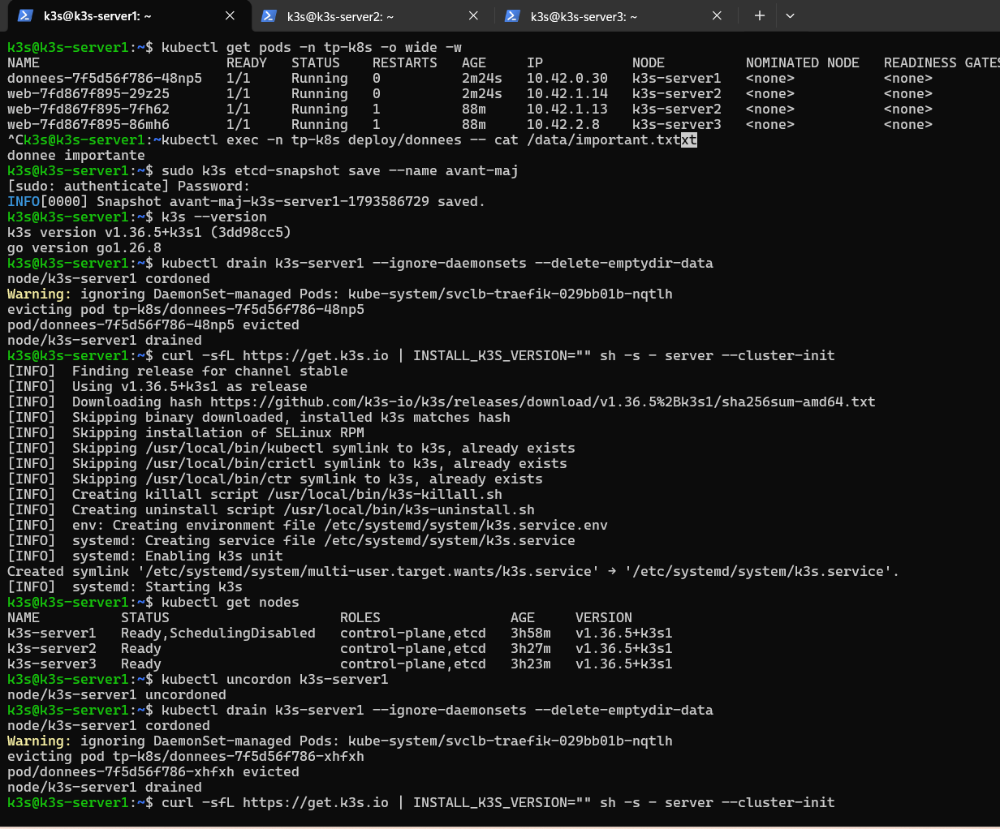

**capture11**

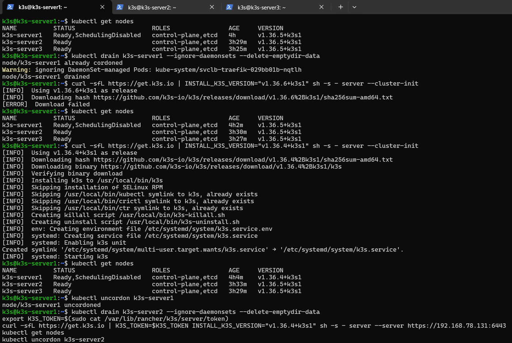

**capture12**

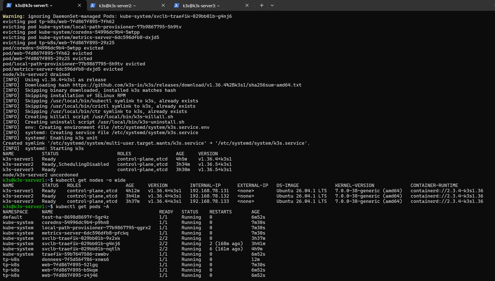

**capture13 server2**


**capture1**

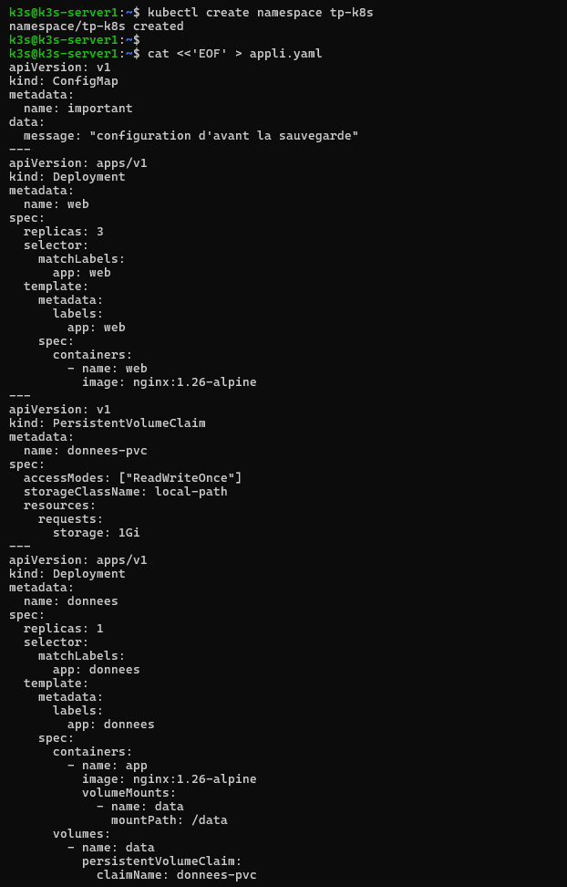

**capture2**

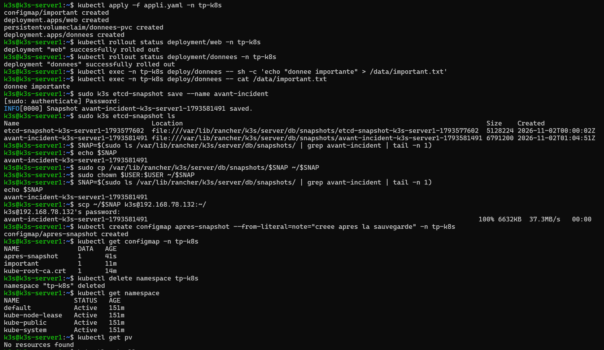

**capture3**

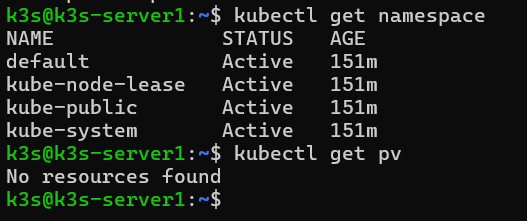

**capture4**

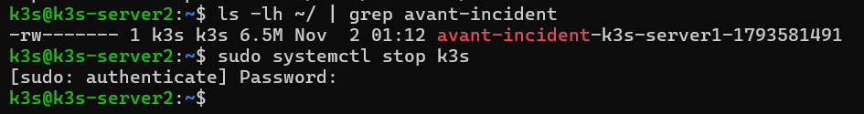

**capture5**

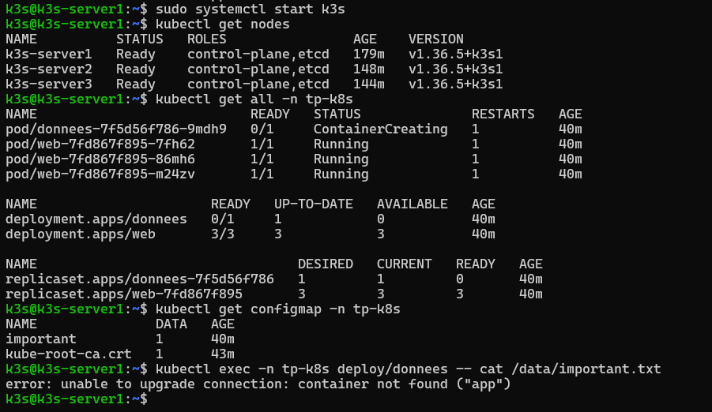

**capture6**

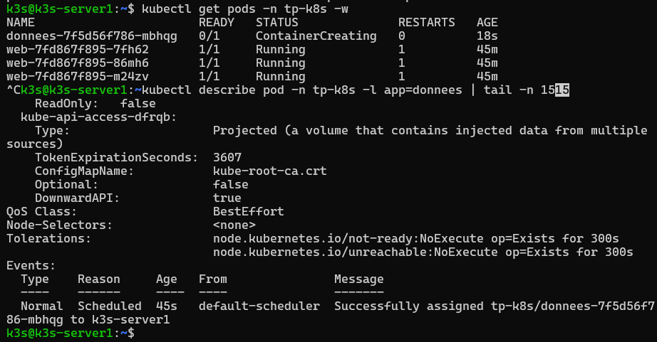

**capture7**

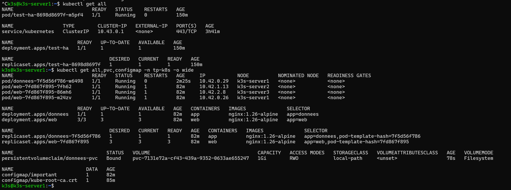

**capture8**

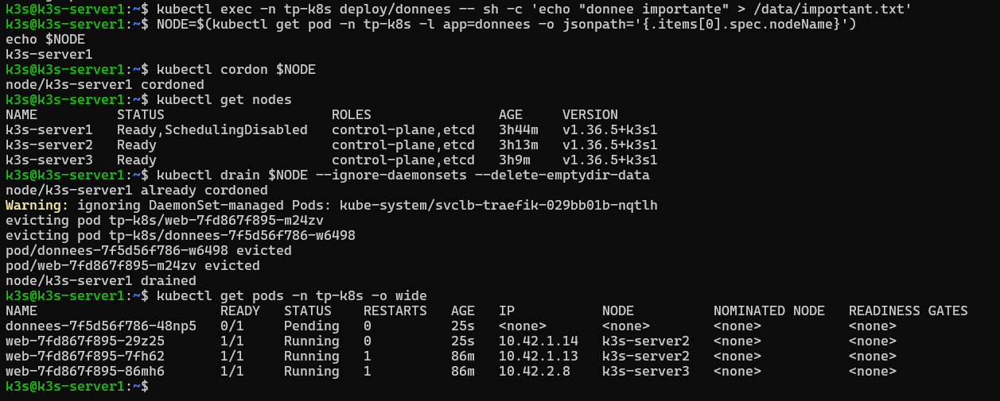

**capture9**

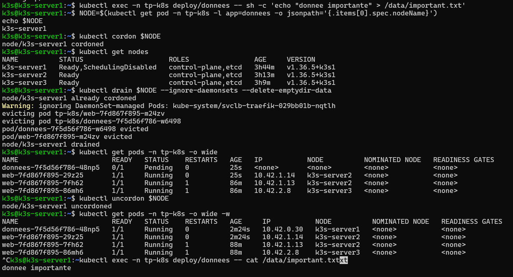

